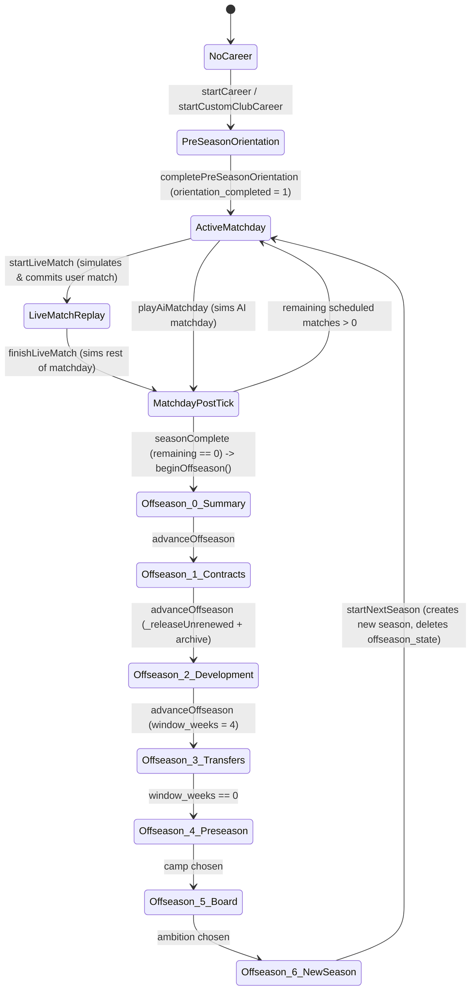

# 01 — PRD Desain Game, Core Gameplay Loop, Offseason & Sistem Narasi

> **Sumber kode terverifikasi:** `lib/game/career_service.dart` (4.437 baris), `lib/game/offseason.dart`, `lib/game/manager_offer_service.dart`, `lib/game/custom_club_service.dart`, `lib/game/news_engine.dart`, `lib/game/club_life_news.dart`, `lib/data/repositories/news_repository.dart`, `lib/data/repositories/message_repository.dart`, `lib/data/repositories/season_repository.dart`, `lib/state/career_provider.dart`.

---

## 1. Visi Produk & Pilar Desain

**Naratama Gelanggang** adalah game karier manajer sepak bola single-player **offline-first**. Pemain berperan sebagai manajer satu klub (dari 2.014 klub nyata di 254 negara, atau membuat klub sendiri dari nol) dalam karier multi-musim yang mencakup kompetisi domestik multi-divisi, piala nasional, piala kontinental & antarklub dunia, serta dinamika tim nasional yang berjalan paralel.

### Pilar Utama
1. **Tanpa Koneksi & Tanpa Monetisasi P2W:** Semua data klub, pemain, jadwal, dan logika berjalan lokal di SQLite.
2. **Ritme Fleksibel:** Bisa menonton pertandingan menit-per-menit (kecepatan 1x/2x/4x/Skip + VAR + Adu Penalti) atau simulasi cepat satu matchday.
3. **Karier Jangka Panjang:** Pemain menua, berkembang sesuai potensi & fasilitas, pensiun, regenerasi akademi/scouting, nilai pasar dinamis, promosi/degradasi, tawaran pindah klub untuk manajer, hingga rekor sejarah & Annual Awards Gala.
4. **Konsistensi Dunia:** Klub AI ikut berlatih tiap minggu, bertarung di bursa transfer (bidding war), merekrut sponsor, mendapat hak siar, dan meregenerasi akademi agar dunia tetap hidup setelah 5–20+ musim.

---

## 2. State Machine Siklus Hidup Karier

> **Aturan Jam Permainan (Discrete Event Clock):** Game **tidak** menjalankan loop hari-demi-hari untuk hari kosong. Waktu melompat antar tanggal pertandingan (`matches.date`, format ISO `YYYY-MM-DD`).

| State | Kondisi Persisten di SQLite | Nilai `nextDate` Aktif |
|---|---|---|
| `NoCareer` | Tabel `seasons` / `career_history` kosong | `None` |
| `PreSeasonOrientation` | `career_state(season_id).orientation_completed == 0` | `career_state.pre_season_date` (`matchesToday = []`) |
| `ActiveMatchday` | `orientation_completed == 1` (atau baris tidak ada), `offseason_state` kosong, ada `matches.status = 1` | `MIN(date)` dari `matches WHERE season_id = ? AND status = 1` |
| `LiveMatchReplay` | State memori `liveSession != None` (laga user sudah tersimpan ke DB, sisa matchday belum) | Sama dengan `nextDate` sampai `finishLiveMatch()` |
| `Offseason` | Baris singleton `offseason_state(id = 1)` ada (`step ∈ 0..=6`) | `None` |

---

## 3. Alur Pembuatan Karier Baru

Terdapat dua jalur pembuatan karier (keduanya diawali memilih 1 dari **5 Save Slot**, mereset slot dari DB referensi bawaan):

### 3.1 Jalur Standar (`startCareer`)
1. Simpan identitas manajer ke `manager_profile (id = 1, name, country_id)`.
2. Muat semua liga domestik (`organization = 1`), piala nasional (`organization = 3`), dan piala kontinental (`international_slots`) untuk negara pilihan.
3. Jalankan `SeasonGenerator.generateCareer(...)`: membuat `seasons`, `season_tournaments`, `season_teams`, jadwal `matches` & `country_matches`, dan 3 jendela `international_windows`.
   - *Catatan Trigger SQLite:* Insert ke `season_teams` otomatis memicu `t_process_loans` (0–1 pemain non-top-6 per klub masuk daftar pinjam) dan `t_sell_players` (0–3 pemain non-top-6 per klub masuk daftar jual) untuk klub ber-skuad > 20.
4. Simpan jangkar karier ke `career_history (team_id, season_id, country_id)`.
5. Jadwalkan 3 laga uji coba pra-musim (`tournament_id = 9999`, H-17, H-10, H-3 sebelum kickoff liga).
6. Pastikan 2 jendela transfer per negara lewat `TransferWindowManager.ensureWindowsForSeason`.
7. Aktifkan gerbang **Pre-Season Orientation**: `career_state(season_id, orientation_completed = 0, pre_season_date = summerWindow.startDate ?? '${startYear}-07-01')` dan kirim surat sambutan dari `'Dewan Direksi'`.
8. Inisialisasi dunia AI: `beginSession()` (snapshot sesi), `replenishAIAcademies`, `refreshAiFormations`, lalu `refreshWorld()`.

### 3.2 Jalur Create-Your-Own-Club (`startCustomClubCareer` / `CustomClubService`)
Memungkinkan pemain merancang klub dari nol yang menggantikan klub terlemah di divisi terbawah negara pilihan:
- **Validasi `CustomClubSpec`:**
  - `managerName` tidak kosong; `name` 3–60 karakter; `abbreviation` tepat 3 huruf (`^[A-Za-z]{3}$`, uppercase); `city` tidak kosong; `stadiumName` 1–60 karakter; `foundedYear` `1800..=tahunIni`.
  - Cek keunikan nama & singkatan (`COLLATE NOCASE`) terhadap semua klub aktif (`division > 0`) di negara tersebut.
- **Konfigurasi Visual & Aset:**
  - `BadgeShape`: `shield`, `circle`, `diamond`, `classic`.
  - `BadgeSymbol`: `soccer`, `star`, `crown`, `eagle`, `flame`.
  - `JerseyPattern`: `plain`, `stripesVertical`, `stripesHorizontal`, `diagonal` + warna home/away (catatan: warna jersey & `nickname` hanya dipakai preview UI; hanya PNG crest 128×128 berformat Base64 yang disimpan ke `teams.logo_base64`).
- **Arsitektur Stadion (`StadiumArchitecture`):**
  - `compact` (8.000 kursi), `modern` (16.000 kursi), `grand` (26.000 kursi).
  - Pembagian kapasitas: `general = 55%`, `stand = 25%`, `terrace = 14%`, `boxes = sisa (6%)`. Setiap kapasitas maksimum `max_* = round(capacity_* * 1.5)`.
- **Preset Skuad Awal (`InitialSquadPreset`, 18 pemain tetap):**
  - Urutan 18 `position_id`: `[1, 1, 2, 2, 3, 4, 4, 5, 5, 7, 7, 8, 8, 6, 9, 10, 10, 11]`.
  - Kapten = index 2 (`CB`), starter = index `0..10`, cadangan = `11..17`, nomor punggung `1..18`, kontrak 3 tahun (`startYear-07-01` s/d `startYear+3-06-30`), tinggi `172..189` cm, nilai awal `(power^2 * 120) + (potential * 80)`.
  - | Preset | Budget Awal | Usia | OVR (`power`) | Potensial | Gaji/Minggu |
    |---|---:|---|---:|---|---:|
    | `youngLocal` | $6.000.000 | 18–21 | 50–54 | `power + 22..31` (72–85) | $3.000–$4.499 |
    | `extraBudget` | $25.000.000 | 20–27 | 48–52 | `power + 8..14` (56–66) | $2.500–$3.699 |
    | `balanced` | $8.000.000 | 6 pemain 19–21, 12 pemain 24–29 | 53–58 | `power + (age<=21?16:6) + 0..5` | $4.000–$5.999 |
- **Transaksi Penyisipan:**
  1. Klub terlemah (power terendah di `MAX(division_id)` negara tersebut) diturunkan keluar piramida (`division = 0`).
  2. Insert `stadiums`, `coaches` (usia 38), `teams` (`division = lowestDiv`), dan entri `finance_ledger` (`opening_balance`, `board_funding`, `+initialBudget`).
  3. Generate 18 pemain + kontrak + hitung ulang `teams.power` (rata-rata top-11) & `teams.value` (total MV 18 pemain).

---

## 4. Pipeline Eksekusi Matchday

### Jalur A (Laga User Live) vs Jalur B (Simulasi AI / Minggu)
- **Live Match:** `startLiveMatch()` mensimulasikan laga user (`recordEvents: true`) dan **langsung menyimpan hasil ke DB** sebelum membuka `MatchScreen` (pemutar timeline 0'→90'). Saat user klik *Continue*, `finishLiveMatch()` mensimulasikan sisa laga tanggal tersebut (`skipMatchId: userMatchId`), mencatat berita, lalu menjalankan `_tickAfterMatchday()`.
- **AI Matchday / Simulate Week:** `playAiMatchday()` langsung memanggil `simulateMatchday` (catatan: di Flutter meneruskan `skipMatchId: nextUserMatch?.matchId` hanya jika sedang dipanggil saat hari bukan laga user; saat user tidak bertanding semua laga AI disimulasikan), mencatat berita, lalu menjalankan `_tickAfterMatchday()`.

### Urutan Langkah di Dalam `simulateMatchday(seasonId, date)`
1. Ambil semua `matches` dengan `status = 1` pada `date`.
2. Untuk setiap laga:
   - **Jalur Cepat (`simulateMatchFast`)** dipakai jika `!recordEvents && bukan laga user && bukan liga utama user`: memakai Poisson `quickSimulate(homePower + 3, awayPower)`, atribusi pemain cepat (1 GK + 10 outfield), dan `tickSuspensionsForMatch`. Tidak menulis ledger/fatigue/cedera.
   - **Jalur Penuh (`simulateMatch`)** dipakai untuk laga user, liga user, dan piala yang diamati:
     1. Filter skuad: buang pemain cedera (`injuryDaysRemaining > 0`) dan pemain tugas timnas (`international_duty.status = 'active'`).
     2. Kumpulkan `banned` = pemain skorsing pada `CompetitionType` laga ini ∪ pemain tugas timnas.
     3. Hitung bonus fasilitas & staf (`injuryReduction` maks 45%, `tacticalBonus` dari Tactical Analyst ≥ 3★).
     4. Jalankan `MatchEngine.simulate(...)` + resolusi Knockout / 2-Leg (agregat → away goals jika aktif → adu penalti).
     5. Hitung tanggal sembuh cedera (`matchDate + 1..14 hari`).
     6. Simpan atomik via `MatchRepository.saveResult` (update `matches`, insert `match_incidents` & `match_players`, **tick skorsing lama dulu**, baru **insert skorsing kartu merah baru**, lalu terapkan cedera).
     7. Catat net matchday ke `FinanceService.recordMatchday` (tiket + 20% hospitality, merch $3/penonton, -10% ops) untuk tuan rumah.
     8. Kurangi stamina pemain yang tampil (`minutes > 0`): `-8` normal, `-6` (Head Physio 3–4★), `-5` (Head Physio 5★), lantai `15`.
3. **Loop Simulasi Internasional:** Maksimal 6 iterasi memanggil `simulatePendingMatchesThroughDate(seasonId, date)` + `checkAndAdvanceInternationalKnockouts(seasonId, date)`.

### Urutan Langkah Pasca-Matchday (`_tickAfterMatchday`)
1. **Kemajuan Babak Piala (`maybeScheduleNextCupRound`)** untuk semua `cups` aktif (Group→KO, League Phase→KO, KO→KO berikutnya) + `resolveFixtureClashes`.
2. `week += 1` (penghitung jumlah matchday yang dimainkan).
3. **`weeklyHousekeeping(seasonId, userTeamId, currentDate)`** (lihat §5).
4. **`ManagerOfferService.maybeGenerate(...)`** (lihat §7).
5. **`refreshWorld()`** (perbaikan self-match, rescheduling bentrok tugas timnas, update klasemen/leaderboard/inbox/jendela transfer/data internasional & panggilan timnas H-7).
6. **Cek Akhir Musim:** Jika `COUNT(matches WHERE season_id = ? AND status = 1) == 0` → panggil **`beginOffseason()`**.

---

## 5. Urutan 18 Langkah Weekly Housekeeping

Dipanggil satu kali setiap selesai matchday di `_tickAfterMatchday()`:

| # | Langkah | Detail Logika |
|---:|---|---|
| 1 | Tick skorsing legacy | `tickSuspensions()` hanya menurunkan baris lama dengan `competition_type IS NULL` (skorsing modern ditick per laga). |
| 2 | Kepulangan pemain timnas | `releaseConcludedDuties(date)` ubah status `'active'` → `'returned'` bila `return_date < date`; jika ada yg pulang, `snapshotWorldRankings()`. |
| 3 | Pemulihan stamina global | Semua pemain aktif di `season_teams`: jika `fitness <= 40` → `MIN(45, +2)`; jika `> 40` → `MIN(100, +6)`. |
| 4 | Resolusi tanggal | `date = currentDate ?? nextMatchDate ?? todayIso`. |
| 5 | Gaji pemain (semua klub) | `paySalaries(seasonId, date)` potong **100% gaji mingguan** (`-SUM(salary)`) ke `finance_ledger` (`player_wages`). Boleh negatif (tidak di-clamp 0). |
| 6 | Sponsor (semua klub) | `ensureSeasonDeals` (auto-sign 3 slot AI sekali/musim) + `payWeeklyAll` (bayar cicilan mingguan semua klub ke `sponsorship_weekly`). |
| 7 | Gaji scout (user) | Potong `SUM(scouts.salary)` ke `staff_wages`. |
| 8 | Bonus pemulihan Medis & Physio (user) | Tambahan recovery user: sehat `+(medicalLevel-1) + round(physioStars/2)` (maks 100); `<=40` `+physioStars + (medicalLevel>=3?2:0)` (maks 55). |
| 9 | Gaji staf kepelatihan (user) | Potong `SUM(team_staff.salary)` ke `staff_wages`. |
| 10 | Cicilan hak siar (Broadcast) | `BroadcastService.payDueInstallments`: cicilan 1 di minggu pertama, cicilan 2 saat ≥50% laga musim selesai; kirim inbox ke user. |
| 11 | Injeksi darurat direksi | `emergencyInjections`: untuk setiap klub di `season_teams` dengan `budget < 0` yang belum mendapat injeksi musim ini (maks 1×/musim), suntik `+(-budget)` (`board_funding`), tandai `distress = 1`. Klub yang masih merah ditandai `distress = 1`. |
| 12 | Akademi Muda (user) | `graduateYouthPlayersIfDue`: setiap 90 hari in-game, hasilkan 5–9 prospek usia 17 + kirim inbox. |
| 13 | Jendela transfer | `ensureWindowsForSeason(seasonId, startYear)`. |
| 14 | Eksekusi transfer terjadwal | `processDueScheduledTransfers(date)`: selesaikan semua `status = 9` dengan `effective_date <= date` + kirim inbox ke user. |
| 15 | Notifikasi jendela transfer | Deteksi transisi Buka / Deadline Day / Tutup dibanding `_lastHousekeepingDate` → kirim inbox. |
| 16 | Tawaran untuk pemain listed (user) | Jika jendela terbuka & pending incoming `< 2`, peluang `40%` (deadline `75%`) memicu 1 tawaran beli/pinjam AI. |
| 17 | Aktivitas pasar AI (`_runMarketAi`) | Peluang `45%` (deadline `95%`): lelang antar-AI (1–4 penawar, maks 1 deal/minggu), tawaran tak diminta (*unsolicited*) untuk pemain user (`22%`/`55%`), dan tawaran permanenisasi pemain pinjaman user yang bersinar (`35%`/`65%`). |
| 18 | Latihan mingguan AI (`runAiTraining`) | Semua klub AI pilih top 3 pemain (`power < potential`), 90% peluang `+1 OVR`, potong `$75K` bila mampu, refresh team power. |

---

## 6. Offseason 7-Tahap & Annual Awards Gala

Persisten pada tabel singleton `offseason_state (id = 1, season_id, step 0..6, report, window_weeks, camp, ambition)`.

### Tahap 0 — `summary` (`beginOffseason`)
1. **Tuntaskan turnamen internasional** hingga `endYear-08-31` (7 iterasi sim + knockout advance + 1 sim final).
2. **Hadiah Kompetisi (`PrizeEngine`):** Distribusikan hadiah liga & piala secara idempoten (`competition_prize_awards`) + surat juara/hadiah.
3. **Tutup tahun fiskal:** `FinanceService.completeSeason(seasonId)` (auto-upgrade mode `relaxed` → `standard` setelah 2 musim).
4. **Annual Awards Gala (`recordSeasonAwards`)** — dievaluasi khusus dari laga **liga domestik utama**, minimal `10` penampilan (`apps >= 10`), rating disimpan dalam skala `0.0..10.0`:
   - **Golden Boot (`type=1`):** `SUM(goals) DESC, SUM(assists) DESC, AVG(rating) DESC`.
   - **MVP (`type=2`):** `SUM(mvp) DESC, AVG(rating) DESC, (goals+assists) DESC`.
   - **Best Young Player (`type=3`):** `age <= 21`, `AVG(rating) DESC, (goals+assists) DESC`.
   - **Ballon d'Or / Player of the Year (`type=4`):** Skor `AVG(rating)*1.2 + goals*3.0 + assists*2.0 + mvp*6.0` (catatan: `mp.rating` mentah 0–100 dipakai di SQL!).
   - **Golden Glove (`type=5`):** `position_id = 1`, `clean_sheets DESC, avg_rating DESC`.
   - **Manager of the Year (`type=7`):** Tim dengan `wins DESC, draws DESC` di liga.
   - **Team of the Year / Once Ideal (`type=6`, 4-3-3):** 1 GK (`avg_rating + clean_sheets*0.35`), 4 DEF, 3 MID, 3 ATT (`apps >= 10, minutes >= 450`, fallback tanpa batas bila kurang).
5. **Catat `career_history`** (W-D-L, GF-GA, daftar trofi musim).
6. **Promosi & Degradasi** antar divisi berurutan di negara klub user (`teams.division` bertukar).
7. **Evaluasi target sponsor** (`evaluateSeasonTargets`) & **Penyelesaian target direksi** (`board_objectives`: bila `userRank <= target_rank`, bayar `bonus` sebagai `board_funding`).

### Tahap 1 — `contracts` (`_enterContracts`)
1. **Tarik pinjaman selesai** (`team_loans` dengan tahun `date_to <= seasonEndYear` kembali ke klub induk, `market_status = 1, squad_status = 0`).
2. **Penuaan & Pensiun (`_ageAndRetire`):** Semua pemain aktif `age += 1`; pensiun (`status_id = 2`) bila **`age >= 41` atau `(age >= 37 && power < 55)`**; kontrak AI yang habis diperpanjang otomatis `+2 tahun`.
3. **Pemeliharaan AI:** `replenishAIAcademies`, `refreshAiTransferListings`, `refreshAiFormations`.
4. **Kontrak habis user:** Daftar pemain user dengan kontrak berakhir `<= seasonEndYear` (kecuali yg punya transfer terjadwal keluar). Syarat perpanjangan: gaji naik **`+15%`**, bonus tanda tangan **`2 × newSalary`**, durasi `+2 tahun`.

### Tahap 2 — `development` (`_releaseUnrenewed` + `_enterDevelopment`)
1. Pemain user yang kontraknya tidak diperpanjang dilepas gratis ke klub acak terdaftar.
2. **Evaluasi Performa Musim (`_evaluateSeasonPerformanceAndWages`, WAJIB sebelum arsip!):**
   - Pemain dengan `apps >= 8 && (avgRating >= 7.0 || goals+assists >= 10)`: bila `power < potential` naik `+2` (`avgRating >= 7.5`) atau `+1`; bila sudah mencapai potensial tapi `age <= 25`, naik `+1` dan **potensial ikut terdorong naik**.
   - Pemain user `apps >= 10 && avgRating >= 7.0` mengirim surat `Wage Increase Request` (`+25%` atau `+$500`).
   - Pemain muda cadangan AI (`age <= 23`, 0 laga) punya peluang 50% naik `+1`.
3. **Kurva Perkembangan & Penurunan Deterministik (`_developPlayers`):**
   - Usia `<= 23` (`power < potential`): `+1..+3` (`1 + (id*7 + age*13) % 3`).
   - Usia `24..27` (`power < potential`): `+0..+1` (`(id*7 + age*13) % 2`).
   - Bonus **Training Ground** (`training_level > 1`): pemain `age <= 21` mendapat tambahan `+1` (Lv2–3) atau `+2` (Lv4–5).
   - Penurunan Veteran: usia `31..33` turun `0..2`, usia `>= 34` turun `1..2` (lantai `40`).
   - Smooth update nilai pasar (`PlayerValuationService.smoothValueUpdate`).
4. **Arsip Musim:** Set `season_tournaments.status = 0` → memicu pemindahan statistik ke `player_season_stats` & `player_season_stats_countries` dan menghapus baris detail `match_players` / `match_incidents`.
5. **Refresh Global:** Hitung ulang semua `teams.power`, `countries.power`, dan `snapshotWorldRankings()`.

### Tahap 3 — `transfers`
- Selesaikan transfer terjadwal per `endYear-07-01`.
- Berikan jendela transfer offseason **`window_weeks = 4`**. User bisa maju `+1 Week` atau `Skip to deadline` (tiap minggu menjalankan `5 × _runMarketAi`).

### Tahap 4 — `preseason` (`PreseasonCamp`)
| Opsi | Biaya (`budget` delta) | Stamina Hasil | Efek Tambahan |
|---|---:|---:|---|
| `rest` (*Rest & recover*) | `$0` | `100%` | — |
| `training` (*Intensive camp*) | `-$400.000` | `100%` | Top 3 pemain user `age <= 23 && power < potential` naik `+1 OVR` |
| `tour` (*Commercial tour*) | **`+$750.000`** | `85%` | Tambah kas klub |

### Tahap 5 — `board` (`BoardAmbition`)
Hitung `expected` rank berdasar urutan `teams.power` di divisi, lalu `performanceMultiplier` (`0.5..1.5`) dari pencapaian musim lalu vs ekspektasi. `managementGrant = round(max(300K, budget * 0.05) * performanceMultiplier)`.

| Ambisi | Offset Rank | Rate Bonus | Advance (Dibayar Di Muka) |
|---|---:|---:|---|
| `safe` | `expected + 3` | `3%` budget (min `$300K`, bulat `$10K`) | `bonus / 2` (+ `managementGrant`) |
| `balanced` | `expected` | `7%` budget (min `$300K`) | `bonus / 2` (+ `managementGrant`) |
| `ambitious` | `expected - 3` | `15%` budget (min `$300K`) | `bonus / 2` (+ `managementGrant`) |

### Tahap 6 — `newSeason` (`startNextSeason`)
- Cek apakah user menerima tawaran pindah klub (`ManagerOffer.acceptedMove`).
- Cek tiket bonus kontinental/global dari juara musim sebelumnya (Juara ACL Two → ACL Elite & AFC Super Cup; Juara ACL Elite → AFC Super Cup, Intercontinental Cup, Club World Cup; Juara UCL → UEFA Super Cup, Intercontinental Cup, Club World Cup; Juara UEL → UEFA Super Cup & UCL).
- Generate musim baru `startYear + 1`, jadwalkan 3 friendly pra-musim, proses transfer terjadwal `startYear-07-01`, hapus `offseason_state`, kedaluwarsakan manager offer terbuka, pindahkan user jika pindah klub, muat `pendingGala` untuk ditampilkan sebagai banner di Overview!

---

## 7. Sistem Karier Manajer & Job Offers (`ManagerOfferService`)

- **Tidak ada sistem pemecatan (firing/sacking)** dan **tidak ada skor board confidence** dalam kode saat ini.
- Setiap matchday, `maybeGenerate(seasonId, date, userTeamId)` memeriksa syarat:
  1. Tidak ada tawaran `pending (0)` atau `accepted (1)`.
  2. Cooldown **≥ 28 hari** sejak tawaran terakhir.
  3. Minimal 5 laga dari 8 laga terakhir di musim ini telah dimainkan, dengan **`winRate >= 0.50`**.
  4. Roll peluang: **`0.08 + (winRate - 0.50) * 0.25`** (8% di WR 50% hingga 20.5% di WR 100%).
  5. Pilih klub acak di `season_teams` dengan **`myPower + 3 <= club.power <= myPower + 20`**.
- Kontrak 2–3 tahun, bintang prestise `ceil((power - myPower) / 4).clamp(1, 5)`, target berdasar selisih power (`>=14` juara, `>=8` top 4, sisanya papan atas).
- Dikirim sebagai pesan inbox **`type = 77`**. Menerima tawaran **tidak langsung memindahkan klub di tengah musim** — perpindahan dieksekusi mulus saat `startNextSeason()`.

---

## 8. Berita (`NewsEngine`, `ClubLifeNews`) & Inbox (`MessageRepository`)

### 8.1 News Engine (3 Scope & 23 Detektor)
- Tabel `news` memakai kunci idempoten `ref TEXT UNIQUE`.
- **Aturan Feed (`NewsRepository.feed`):**
  - `'world'`: `scope = 'world' OR importance >= 5`
  - `'region'`: `scope = 'region' OR (scope = 'league' AND importance >= 3)`
  - `'league'`: `scope = 'league'`
- **Preview Awal Musim:** Prediksi 3 kandidat juara & tim terlemah liga (`pre:league:$s`), preview piala kontinental (`pre:cup:$s:$c`), dan penanda baseline transfer (`meta:transfers`).
- **Detektor Matchday:** Final Piala (`imp=5`), Upset (selisih power ≥ 8, `imp=3..5`), Pesta Gol (margin ≥ 4), Laga Seru (total gol ≥ 6), Hat-trick+ (`goals >= 3`), Roundup (`>=3` laga), Pergantian Pemuncak Klasemen, Perebutan Gelar (jarak ≤ 3), Pemimpin Dominan (jarak ≥ 7), Kunci Juara Matematis (`imp=5`), Zona Degradasi & Degradasi Pasti, Rentetan Menang (4/6/8/10/12), Tak Terkalahkan (6/8/10/12), Krisis Kalah (3/5/7), Tanpa Menang (5/7/9), Clean Sheet (3/5), Paceklik Gol (3), Pemain Terbaik Matchday, Persaingan Top Skor, Pemimpin Grup, serta **Transfer ≥ $1M** (termasuk mendeteksi hingga 3 klub rival yang kalah lelang di `transfer_offers`!).

### 8.2 Club Life News & Formula `fanMood`
- **`fanMood` (stateless, 0–100):** Ambil 6 laga terakhir klub user lintas kompetisi. Jika kosong = `60`. Jika ada: mulai `55.0`, **Menang `+8`**, **Seri `-1`**, **Kalah `-9`**, clamp `[0, 100]`.
- Menghasilkan cerita berkala (berdasar modulo tanggal integer `YYYYMMDD`):
  - **Fans:** kalah 3+ beruntun (`anger`), menang 3+ beruntun (`joy`), atau `day % 9 == 0` (koreografi/waspada/protes).
  - **Keuangan (`day % 11 == 3`)**, **Direksi (`day % 17 == 5`)**, **Kehidupan Pemain (`day % 7 == 2`)**, **Rumor Manajer (`day % 23 == 7 && mood >= 65`)**.

### 8.3 Inbox & Retensi Pesan
- Tabel `messages` memiliki **SQLite Trigger `t_delete_old_messages`** yang otomatis mempertahankan **hanya 20 pesan terbaru secara global** setiap kali `INSERT`.
- **Dispatch Interaktif di UI:**
  - `type == 77` → Manager Offer Sheet.
  - `transfer_offer_id != null` → Dialog Negosiasi Transfer/Pinjaman (Terima / Tolak / Counter / Negosiasi Kontrak).
  - Prefix judul `'Youth Academy Intake'` → Lembar Review Prospek Akademi.
  - Prefix `'Permohonan Panggilan Uji Coba Timnas'` / `'Permohonan Uji Coba Timnas'` → Dialog Pelepasan Pemain Timnas.
  - Prefix `'Wage Increase Request'` + `player_id` → Tombol *Grant Wage Increase* (`renewContract`).
- *Catatan untuk Rust:* Disarankan menaikkan batas retensi (mis. 100–200 pesan) atau tidak menghapus pesan bertanda `actionable/unread` agar surat tawaran tidak tergusur saat hujan notifikasi akhir musim.

