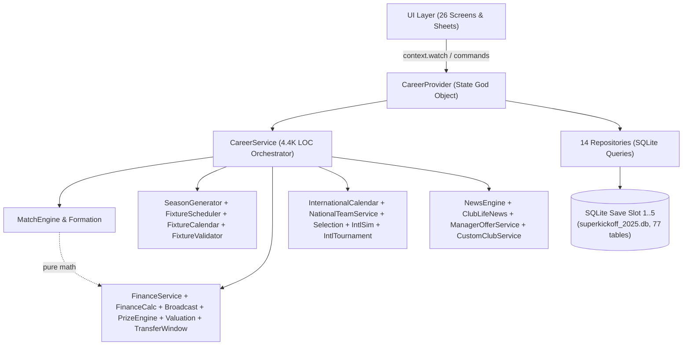

# Naratama Gelanggang (Superkickoff) — Master PRD & Spesifikasi Teknis Rewrite ke Rust Desktop

> **Status Dokumen:** Audit Lengkap & Spesifikasi Implementasi (Code-Verified)  
> **Sumber Analisis:** `/home/alif/projects/Flutter/superkickoff` (85 file Dart produksi, 63.523 baris kode, 60 suite pengujian, database SQLite `superkickoff_2025.db`, seluruh dokumen audit/keuangan, serta knowledge graph `graphify-out/`)  
> **Target Rewrite:** Game Manajemen Sepak Bola **Desktop Native berbasis Rust** (offline-first, deterministik, performa tinggi, multi-pane UI)

---

## 1. Gambaran Umum Produk (Kondisi Implementasi Aktual)

**Naratama Gelanggang** (nama kode proyek: `superkickoff`) adalah game simulasi karier manajer sepak bola **100% offline-first** berbasis database SQLite lokal.

> **Catatan Penting (Perbedaan PRD Lama vs Implementasi Aktual):**  
> File lama `PRD_Superkickoff_Clone.md` adalah draf reverse-engineering awal dari game referensi berbahasa Spanyol (dengan tabel `eq_equipos`, koin/IAP, iklan, dan Firebase). **Implementasi aktual di `lib/` dan `assets/data/superkickoff_2025.db` telah jauh berevolusi**:
> - Seluruh skema database sudah dimigrasi ke **Bahasa Inggris** (`teams`, `players`, `matches`, `finance_ledger`, dll.) dengan total **77 tabel**.
> - **100% offline tanpa monetisasi agresif** (tidak ada coins, tidak ada IAP, tidak ada ads, tidak ada Firebase/auth).
> - Dilengkapi sistem mendalam: **Buku Besar Keuangan (Immutable Ledger)**, hak siar 2 cicilan, sponsor 3 slot untuk semua klub, mesin valuasi pasar pemain (kurva Hermite), pasar transfer + jendela transfer per negara + pinjaman + transfer terjadwal, fasilitas klub + staf kepelatihan + dossier analisis taktis, akademi muda + scouting wonderkid, kalender global terpadu + *conflict resolver*, sepak bola internasional lengkap (siklus 4 tahunan Piala Dunia 48 tim, EURO, Piala Asia, Nations League, FIFA ASEAN Cup, Elo FIFA), Custom Club Creator, dan Annual Awards Gala.

### Skala Dataset Bawaan (`assets/data/superkickoff_2025.db`)
| Entitas | Jumlah | Catatan |
|---|---:|---|
| Negara (`countries`) | **254** | 6 konfederasi (CONCACAF, CONMEBOL, UEFA, CAF, AFC, OFC) + 40 wilayah non-FIFA; 216 negara punya poin FIFA 2024 awal |
| Klub (`teams`) | **2.014** | Divisi 1 (995), Divisi 2 (704), Divisi 3 (315); budget $500K–$90M |
| Pemain (`players`) | **55.624** | Usia 15–49, OVR 15–91, Potensial 26–100, MV $15K–$179.5M, Gaji $10K–$280.8K/mgg |
| Pelatih (`coaches`) | **2.014** | 1 pelatih referensi per klub |
| Stadion (`stadiums`) | **2.014** | 4 tier kursi (`general`, `stand`, `terrace`, `boxes`) + kapasitas maks |
| Turnamen (`tournaments`) | **228** | 116 Liga Domestik, 60 Piala Nasional, 51 Kontinental/Internasional/Super Cup, 1 Pra-Musim |
| Posisi / Skill / Tipe Wasit | **11 / 25 / 5** | 11 posisi (4 grup), 25 master skill, 5 temperamen wasit |
| Aset Logo Bundel | **2.014 klub + 18 liga** | `default_club_logos.json` (43 MB), `default_league_logos.json` (301 KB), `superkickoff_2025.db` (54 MB) |

---

## 2. Peta Pengetahuan & Arsitektur dari `graphify-out/`

Berdasarkan analisis graf `graphify-out/graph.json` dan `GRAPH_REPORT.md` (diperbarui 22 November 2026):
- **Ukuran Graf:** **4.947 node**, **7.089 edge** (95% `EXTRACTED`, 5% `INFERRED`, 0% `AMBIGUOUS`), **168 komunitas**, **0 import cycles**.
- **Distribusi Kode Produksi (`lib/`):** 85 file Dart (63.523 baris):
  - `lib/ui/`: ~25,7K baris (26 layar/sheet + 3 widget + tema)
  - `lib/game/`: ~20,5K baris (28 engine & service domain)
  - `lib/data/`: ~12,1K baris (skema, DB, 4 model file, 14 repository)
  - `lib/state/`: 3.258 baris (`CareerProvider` tunggal)
  - `lib/core/`: ~473 baris (`country_names.dart`, `format.dart`)

### God Nodes & Titik Kopling Tertinggi (Wajib Diurai Saat Rewrite ke Rust)
| Node / File | Derajat Koneksi (Graph) | Baris Kode | Peran & Masalah Arsitektur |
|---|---:|---:|---|
| `lib/data/models/models.dart` | 414 | 2.017 | Seluruh model domain disatukan dalam satu file |
| `lib/state/career_provider.dart` (`CareerProvider`) | 338 (kelas: 122) | 3.258 | **God Object State**: memegang 18+ repo/service, semua layar UI bergantung langsung ke sini, `notifyListeners()` global |
| `lib/game/career_service.dart` (`CareerService`) | 161 | 4.437 | **God Object Orchestrator**: mencampur matchday, housekeeping, AI transfer, AI training, offseason, development, awards, prom/rel |
| `lib/game/match_engine.dart` | 139 | 1.376 | Mesin simulasi murni (inti yang paling bersih untuk di-port ke Rust) |
| `lib/data/db/schema.dart` | 123 | 151 | Konstanta 77 tabel + enum integer status/award/offer/turnamen |
| `lib/ui/screens/international_tab.dart` | 72 | 3.304 | UI monolitik 4 sub-tab Timnas |
| `lib/ui/screens/club_hub_sheet.dart` | 71 | 2.815 | UI monolitik 6 sub-tab Club Hub |

### Aliran Ketergantungan Lapisan Sistem

---

## 3. Indeks Rangkaian Dokumen Spesifikasi (`naratama/`)

Baca secara berurutan untuk memahami seluruh logika sebelum menulis baris pertama kode Rust:

| No | Dokumen | Fokus Domain | Konten Kunci |
|---:|---|---|---|
| **01** | [01_PRD_GAME_DESIGN_AND_CORE_LOOP.md](./01_PRD_GAME_DESIGN_AND_CORE_LOOP.md) | **PRD, Career Loop, Offseason & Narasi** | State machine karier, Pre-Season Orientation, alur Matchday (Live vs Fast), 18 langkah Weekly Housekeeping, Offseason 7-tahap, Annual Awards Gala, Manager Offers, Custom Club Creator, News Engine (23 detektor), Club Life News (`fanMood`), Inbox & trigger 20 pesan |
| **02** | [02_DATABASE_SCHEMA_AND_DATA_MODELS.md](./02_DATABASE_SCHEMA_AND_DATA_MODELS.md) | **Database SQLite & Model Data** | Katalog lengkap 77 tabel + kolom/indeks, data master (divisi, posisi, skill, wasit, konfederasi), 5 trigger SQLite + view `v_countries`, 5 Save Slots & session rollback, pemetaan `struct`/`enum` Rust |
| **03** | [03_MATCH_ENGINE_TACTICS_AND_SQUAD.md](./03_MATCH_ENGINE_TACTICS_AND_SQUAD.md) | **Match Engine, Taktik, Latihan, Fasilitas & Skuad** | Rumus lengkap simulasi menit 1–90, VAR, penalti, rating, MVP, fast-sim Poisson, 6 formasi & `Lineup.best`, Training Ground Lv1–5, Medical Centre Lv1–5, Youth Academy Lv1–10, 3 peran staf + Dossier Taktis, Cedera, dan **Skorsing Kartu Merah Berbasis Kompetisi** |
| **04** | [04_COMPETITIONS_CALENDAR_AND_SCHEDULING.md](./04_COMPETITIONS_CALENDAR_AND_SCHEDULING.md) | **Kompetisi, Generator Musim & Kalender Global** | `CompetitionConfig` (24 profil turnamen), kualifikasi & virtual feeder cup, Circle Method + Simulated Annealing Home-Away Optimizer, UEFA League Phase (Hierholzer Eulerian), Group Snake & Knockout Bracket, Kalender Terpadu 8-pass, Postponement, `FixtureValidator`, Klasemen & Promosi/Degradasi |
| **05** | [05_ECONOMY_FINANCE_TRANSFERS_AND_VALUATION.md](./05_ECONOMY_FINANCE_TRANSFERS_AND_VALUATION.md) | **Keuangan, Valuasi MV, Transfer, Pinjaman & Scouting** | Buku besar immutable (22 kategori), `EconomyScale`, elastisitas tiket + net matchday, hak siar 2 cicilan, Prize Engine, sponsor 3 slot + AI, amortisasi/book value/agent fee/sell-on, FFP (telemetri aktif, sanksi nonaktif), Kurva MV Hermite 19-titik, Transfer Window, state machine penawaran (`1..11`), Pinjaman, dan Scouting Wonderkid |
| **06** | [06_INTERNATIONAL_FOOTBALL_AND_NATIONAL_TEAMS.md](./06_INTERNATIONAL_FOOTBALL_AND_NATIONAL_TEAMS.md) | **Sepak Bola Internasional & Timnas** | Kalender FIFA 3 jendela & blokir klub, Siklus Turnamen 4 Tahunan (Piala Dunia 48, EURO 24, Piala Asia 24, Nations League, FIFA ASEAN Cup 16), eligibilitas ganda & cap-tie, seleksi skuad 23 pemain, persetujuan pelepasan uji coba, rumus FIFA SUM Elo & proteksi gugur, 254 poin awal, grup/best-3rd/bracket/podium |
| **07** | [07_UI_UX_AND_DESKTOP_ADAPTATION_SPEC.md](./07_UI_UX_AND_DESKTOP_ADAPTATION_SPEC.md) | **UI/UX 26 Layar & Blueprint Desktop** | Sistem visual (Midnight Navy `#070D18` + Championship Gold `#E5A93C`), peta navigasi lengkap, spesifikasi fungsional semua 26 layar & modal, dan **cetak biru adaptasi dari Mobile Bottom-Sheet menjadi Desktop Multi-Pane Workspace** |
| **08** | [08_RUST_DESKTOP_ARCHITECTURE_AND_PORTING_GUIDE.md](./08_RUST_DESKTOP_ARCHITECTURE_AND_PORTING_GUIDE.md) | **Arsitektur Rust, Daftar Bug Asli & Roadmap** | Dekomposisi Cargo Workspace (`naratama-model`, `naratama-sim`, `naratama-db`, `naratama-engine`, `naratama-desktop`), evaluasi GUI Rust Desktop (Tauri v2 vs Iced vs egui vs Slint), **Registri 25+ Bug/Quirk di Kode Flutter Asli** (wajib diperbaiki vs opsional), dan Roadmap Rewrite Fase 0–6 beserta matriks pengujian paritas |

---

## 4. Prinsip Emas Rewrite ke Rust

1. **Kompatibilitas Dataset Langsung:** Reuse file `assets/data/superkickoff_2025.db` (55.624 pemain, 2.014 klub, 254 negara) dan `default_club_logos.json` secara langsung lewat `rusqlite` (bundled SQLite). Tidak perlu membuat ulang dataset awal dari nol.
2. **Pure Core Simulation (`naratama-sim`):** Pisahkan seluruh matematika game (Match Engine, Fixture Scheduler, Market Valuation, FinanceCalc, PrizeEngine, Elo) menjadi crate Rust murni tanpa ketergantungan DB maupun UI — mudah di-unit-test, bisa dijalankan deterministik dengan seed RNG (`StdRng::seed_from_u64`), dan simulasi 1 musim penuh bisa selesai dalam milidetik.
3. **Satu Gerbang Transaksi:** Seluruh mutasi uang wajib melalui satu `FinanceService::record_tx(&Transaction, ...)` dengan invarian keras `teams.budget == SUM(finance_ledger.amount)` dan semua tanggal menggunakan **in-game simulation date** (bukan jam dinding OS!).
4. **Hapus God Objects:** Pecah `CareerProvider` & `CareerService` menjadi 9 layanan CQRS terfokus + event slice reaktif agar UI desktop responsif tanpa query berulang.
5. **Desain Desktop-First:** Ubah seluruh 12+ bottom-sheet mobile menjadi *left sidebar*, *persistent top status bar*, *split master-detail tables*, *right inspector drawer*, dan papan taktik *drag/click-to-swap* ramah mouse.

